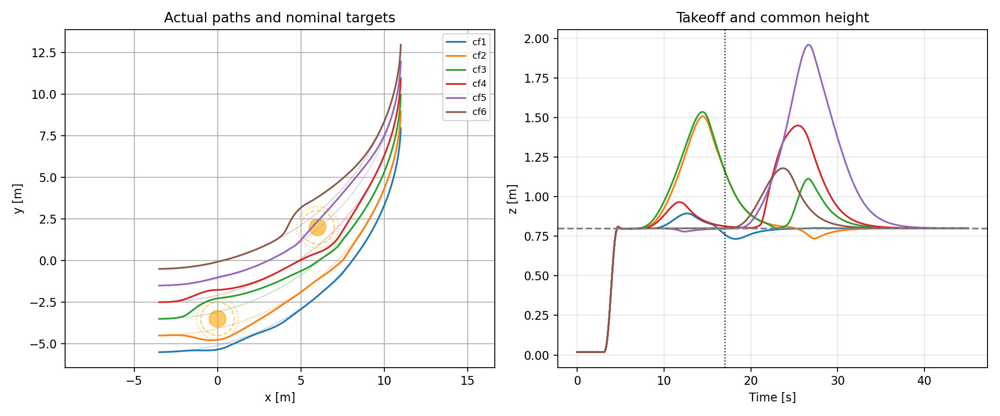

# Safe REDCHO Gazebo — single position bank

**Edition:** `single-position-v0.1.0` · **Package:** `safe_redcho_single_sim` · **Agents:** six

One order-2 position REDCHO bank per aircraft supplies shared position, velocity
and acceleration estimates. The battery model, reference SVFs, formation/height
mission, local HOCBF-QPs, geometric controller, motor allocation and native
Gazebo physics remain in the loop. Six independent ROS controller processes
operate in lockstep; averages used for plots are diagnostics.

## Start here

```bash
git clone --branch single-position-v0.1.0 --depth 1 \
  https://github.com/khubaib007/Safe-Redcho-Gazebo-Simulation.git safe-redcho-single-sim
cd safe-redcho-single-sim
bash scripts/setup.sh numerical
bash scripts/verify.sh
bash scripts/test.sh full
bash scripts/run.sh numerical --duration 45 --plots --output results/first_single_run
```

**[Complete installation, numerical/native tests, GUI/headless runs, telemetry and troubleshooting](docs/single-position/START_HERE.md)**

After installing ROS 2 Jazzy / Gazebo Harmonic and building:

```bash
bash scripts/run.sh simulation \
  headless:=false rviz:=true view:=closeup plots:=true csv:=true duration:=45.0 \
  output:="$PWD/results/single_gui_$(date -u +%Y%m%dT%H%M%SZ)"
```

The world starts paused and the coordinator owns stepping. The inherited
six-aircraft ground-start, height proposals, hover gate, two obstacles, battery
fault at 17 seconds and final formation recovery are retained. Gazebo remains
paused in flight after the experiment. `plots:=true` saves eight scientific
figures; Gazebo/RViz provide the live views. CSV/NPZ telemetry is included.

- [Architecture and scope](src/safe_redcho_single_sim/ANALYSIS.md)
- [Detailed mathematical formulation](src/safe_redcho_single_sim/MATHEMATICAL_FORMULATION.md)
- [Validation and source provenance](docs/single-position/VALIDATION.md)
- [Package documentation](src/safe_redcho_single_sim/README.md)

| Edition | Architecture | Release |
|---|---|---|
| Velocity | Distributed battery-aware velocity consensus | [velocity-v0.1.0](https://github.com/khubaib007/Safe-Redcho-Gazebo-Simulation/releases/tag/velocity-v0.1.0) |
| Formation | Dual-bank velocity and position/height consensus | [formation-v0.1.0](https://github.com/khubaib007/Safe-Redcho-Gazebo-Simulation/releases/tag/formation-v0.1.0) |
| Single position | One position bank with derivative outputs | [single-position-v0.1.0](https://github.com/khubaib007/Safe-Redcho-Gazebo-Simulation/releases/tag/single-position-v0.1.0) |

The repository remains private. Each edition has its own release snapshot;
previous tags are unchanged. The new package is separate in `src/`. Builds,
virtual environments and generated datasets are excluded from source commits.



License: [Apache-2.0](LICENSE). Existing Crazyflie mesh attribution is preserved.
This is simulation validation; it is not physical flight or firmware validation.
Companion: [Safe REDCHO Crazyflies hardware](https://github.com/khubaib007/Safe-Redcho-Crazyflies).
