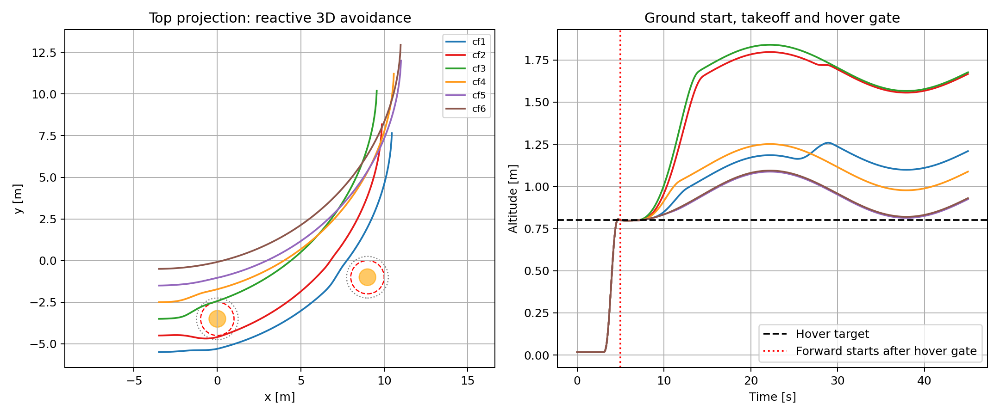

# Safe REDCHO Formation

**Distributed battery-aware velocity consensus and position/height formation with reciprocal HOCBF-QP.** Six simulated Crazyflies, one local controller per aircraft,
two ring neighbors, and a shared plant coordinator. Numerical SE(3) simulation
and a ROS 2 Jazzy / Gazebo Harmonic backend are included.

| Edition | What it adds | Exact release |
|---|---|---|
| Safe REDCHO Velocity | Battery-aware velocity-reference consensus and local safety QPs | [velocity-v0.1.0](https://github.com/khubaib007/safe-redcho-simulation/releases/tag/velocity-v0.1.0) |
| Safe REDCHO Formation | A second REDCHO bank for displacement/height and formation recovery | [formation-v0.1.0](https://github.com/khubaib007/safe-redcho-simulation/releases/tag/formation-v0.1.0) |
| Safe REDCHO Single Position | One position REDCHO bank with derivative outputs and native Gazebo physics | [single-position-v0.1.0](https://github.com/khubaib007/Safe-Redcho-Gazebo-Simulation/releases/tag/single-position-v0.1.0) |

The repository starts private for review; authenticate with your GitHub account to clone it until public access is enabled.

**This checkout is `formation-v0.1.0`.** Each release is a complete workspace. Install
different editions into different folders and use separate terminals for their
ROS overlays. The single-process original baseline is retained as a reference
comparison; this edition's supported mission is distributed.

## Start here: numerical simulation, no ROS required

On Ubuntu 24.04:

```bash
git clone --branch formation-v0.1.0 --depth 1 https://github.com/khubaib007/safe-redcho-simulation.git safe-redcho-formation
cd safe-redcho-formation
bash scripts/setup.sh numerical
bash scripts/verify.sh
bash scripts/test.sh quick
bash scripts/run.sh numerical --duration 45 --plots --output results/first_run
```

The last command runs all six controllers in numerical feedback and writes
`mission_status.json`, `performance_summary.json`, `metadata.json`,
`simulation_data.npz` and PNG figures. Expected: `status: PASS`, 4,501 cycles,
and every evaluated performance check true. The output directory must be new
or empty; choose another name for repeat runs.



## Build and run the ROS/Gazebo version

Install ROS 2 Jazzy first using [the Ubuntu installation guide](https://docs.ros.org/en/jazzy/Installation/Ubuntu-Install-Debs.html).
Then, from a fresh terminal in this checkout:

```bash
bash scripts/setup.sh ros
bash scripts/build.sh --executor sequential
bash scripts/verify.sh --ros
```

Use three terminals, each in this checkout. Start them in order:

```bash
# Terminal 1: a new paused world; no GUI required
bash scripts/run.sh world headless:=true rviz:=false
```

```bash
# Terminal 2: six independent controller processes
bash scripts/run.sh agents
```

```bash
# Terminal 3: coordinate the 45-second simulated mission
bash scripts/run.sh gazebo --duration 45 --no-plots --output results/gazebo_first_run
```

The coordinator advances the paused world automatically. Do not click Play.
After the mission, stop agents and world with Ctrl+C. **Restart both before
another mission**: battery, observer and native step-sequence states persist.
For an automated isolated native check, run `bash scripts/test_native.sh full`
after building. Its test domain/partition and cleanup are described in
[testing.md](docs/testing.md).

For graphical visualization, omit `headless:=true rviz:=false` from Terminal 1.

## Guides

- [Installation and dependencies](docs/installation.md)
- [Algorithm architecture and information exchange](docs/architecture.md)
- [Scenario settings](config/README.md)
- [Running, outputs and shutdown](docs/running.md)
- [Verification and expected results](docs/verification.md)
- [Tests and CI](docs/testing.md)
- [Troubleshooting](docs/troubleshooting.md)
- [Validation scope and release evidence](docs/validation-status.md)
- [Source provenance and release preparation](docs/provenance.md)

## Repository layout

```text
src/           Eight ROS packages and scenario-world generator
scripts/       Consistent setup, build, verify, test and run entry points
config/        Guide to the authoritative scenario settings
docs/          Complete usage and architecture guides
validation/    Small numerical/native verification reports and source hashes
.github/       Numerical/protocol CI
```

Full experimental datasets, local editor indexes, builds and virtual environments
are excluded from source. Existing datasets in the original workspaces were not
moved or deleted. License: [Apache-2.0](LICENSE); Bitcraze mesh attribution remains
in `src/safe_redcho_scene/licenses/BITCRAZE_LICENSE.txt`.

The separate latest single-bank package and complete guide are on the
[`single-position` branch](https://github.com/khubaib007/Safe-Redcho-Gazebo-Simulation/tree/single-position/src/safe_redcho_single_sim).
