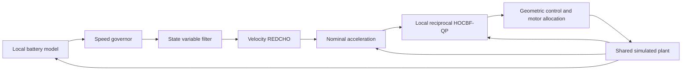

# Safe REDCHO Velocity: algorithm architecture

Distributed battery-aware velocity consensus with reciprocal HOCBF-QP.

For each of six aircraft:

The battery model integrates state of charge and polarization voltage using
locally computed propulsion power. The governor changes each local reference
speed according to battery condition; voltage also limits acceleration authority.
An SVF supplies smooth reference signals and derivatives. REDCHO reconstructs
the average filtered reference through a six-agent ring.

Each aircraft solves its own reciprocal high-order control barrier function
quadratic program. Constraints cover pair separation, obstacle avoidance,
actuator authority and acceleration slew. Invalid or nonfinite hard-constraint
solutions are rejected before motor allocation. A geometric attitude controller
converts the acceleration request into four motor forces.

## Information available to each process

- Ring communication carries reference-observer estimates from two peers.
- The coordinator supplies the common physical-state/previous-acceleration batch.
- Each aircraft computes its own acceleration bound. The coordinator distributes
  the six same-cycle bounds after collecting them.
- A complete six-result barrier precedes every native plant advance.

Thus control/observer computation is distributed, while state transport and plant
stepping are coordinated. The safety algorithm uses information beyond the two
ring neighbors. The coordinator does not replace the six local safety QPs with
a joint centralized QP.

The parallel Levant observer is an instrumented comparison. Motor commands use
the SVF/REDCHO path.

## This edition

The velocity edition has one control-reference REDCHO bank. After takeoff and
the hover gate, its nominal acceleration tracks the common velocity estimate.
Position feedback is used during startup only. There is no position/height
consensus bank or flight formation-restoration term. Collision avoidance may
change relative positions permanently.

## Plant and timing

Numerical mode uses a midpoint SE(3) integrator and simple unilateral floor proxy.
Native Gazebo uses a paused-world service: one excluded 1 ms initialization step,
then ten 1 ms physical steps for each 10 ms controller cycle. Motor forces are
applied as wrenches; physical feedback enters the next cycle.

The mission starts on the floor, takes off from 3.0 to 4.8 s, checks hover at
5.0 s, then starts forward motion. cf2 receives a simulated battery fault at
17.0 s (12 seconds after forward motion begins).

The included original single-process baseline is a separate comparator and has
different starts, obstacles and fault timing. Compare algorithms only after
explicitly aligning scenario assumptions.
